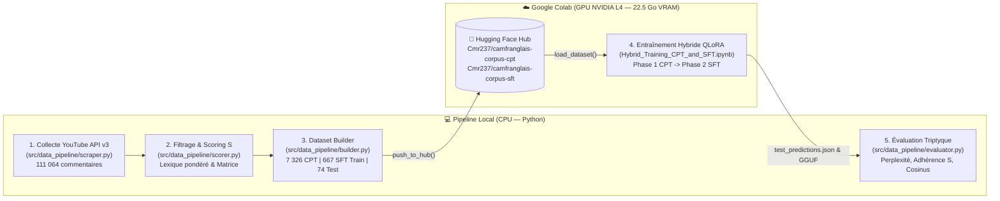

# 🇨🇲 CameroonianAI — LLM Conversationnel en Camfranglais (Hybride CPT $\rightarrow$ SFT avec QLoRA)

**CameroonianAI** est un projet d'adaptation linguistique et conversationnelle d'un Grand Modèle de Langage (**`Mistral-Nemo-Instruct-2407`**, 12.2 milliards de paramètres) au **Camfranglais** (l'argot urbain hybride du Cameroun mêlant français, anglais, pidgin et langues locales).

Le projet met en œuvre une architecture **MLOps hybride** séparant :
1. **La collecte, le filtrage linguistique mathématique et la construction des datasets en local (CPU)** via un pipeline Python modulaire ([`src/data_pipeline/`](src/data_pipeline/)).
2. **L'entraînement QLoRA en 2 phases (Continued Pre-Training $\rightarrow$ Supervised Fine-Tuning) sur GPU NVIDIA L4** dans le notebook **[`Hybrid_Training_CPT_and_SFT.ipynb`](Hybrid_Training_CPT_and_SFT.ipynb)**, synchronisé via **Hugging Face Hub**.

---

## 🏗️ Architecture Globale du Pipeline



---

## 📂 Structure du Dépôt

```text
CameroonianAI/
├── config/
│   ├── lexicon.json                     # Dictionnaire pondéré du Camfranglais (marqueurs forts w=2.0, moyens w=1.0, ancres syntaxiques)
│   └── youtube_seeds.json               # Requêtes et paramètres de collecte YouTube Data API v3 (237, Mbolé, humour, web-séries)
├── data/
│   ├── raw/
│   │   ├── raw_comments.jsonl           # 111 064 commentaires YouTube extraits (92 476 isolés + 12 000 paires Parent -> Enfant)
│   │   └── scraped_videos.txt           # Journal d'idempotence des vidéos déjà collectées
│   └── final/
│       ├── cpt_train.json               # 7 326 textes en Camfranglais pur pour la Phase 1 (CPT)
│       ├── sft_train.json               # 667 dialogues [User -> Assistant] pour la Phase 2 (SFT)
│       └── sft_test.json                # 74 dialogues de test (Hold-out 10 %) pour l'évaluation
├── src/
│   └── data_pipeline/
│       ├── scraper.py                   # Extraction YouTube en arbres (Commentaires isolés vs Réponses Parent -> Enfant)
│       ├── scorer.py                    # Funnel de nettoyage & Formule mathématique de scoring linguistique S
│       ├── builder.py                   # Assemblage CPT/SFT, Règle d'Or SFT, Rétro-Prompting Gemini & Push Hugging Face
│       ├── evaluator.py                 # Triptyque d'évaluation (Perplexité, Camfranglais Adherence Score, Similarité Cosinus)
│       └── run_pipeline.py              # Script orchestrateur exécutant tout le pipeline local de bout en bout
├── conv_bot.json                        # Noyau de dialogues manuels de référence en Camfranglais
├── Hybrid_Training_CPT_and_SFT.ipynb    # Notebook d'entraînement QLoRA (Phase 1 CPT -> Phase 2 SFT) sur GPU NVIDIA L4
├── requirements.txt                     # Dépendances Python
└── .env.example                         # Modèle des variables d'environnement (YOUTUBE_API_KEY, HF_TOKEN, GEMINI_API_KEY)
```

---

## 🧠 Méthodologie Scientifique

### 1. Pourquoi une Stratégie Hybride (CPT $\rightarrow$ SFT) ?

| Approche | Données utilisées | Ce que le modèle apprend | Limite si utilisée seule |
| :--- | :--- | :--- | :--- |
| **Phase 1 : Continued Pre-Training (CPT)** | **$7\,326$ textes bruts** ([`Cmr237/camfranglais-corpus-cpt`](https://huggingface.co/datasets/Cmr237/camfranglais-corpus-cpt)) | Assimile le vocabulaire (*wanda, mbom, ndem, mbindi, tchop, ngata*), la syntaxe et les expressions camerounaises via la prédiction du token suivant. | *Catastrophic Forgetting* du format assistant : le modèle parle comme une section commentaires YouTube. |
| **Phase 2 : Supervised Fine-Tuning (SFT)** | **$667$ dialogues** ([`Cmr237/camfranglais-corpus-sft`](https://huggingface.co/datasets/Cmr237/camfranglais-corpus-sft)) | Réapprend la posture d'interlocuteur (`[INST] ... [/INST]`) grâce au masquage de la *loss* sur la question (`train_on_responses_only`). | Vocabulaire trop limité si les poids LoRA n'ont pas d'abord absorbé le bain linguistique du CPT. |
| **Hybride CPT $\rightarrow$ SFT (Notre approche)** ✅ | **$7\,326$ CPT + $667$ SFT** | **Les mêmes adaptateurs LoRA (`r = 32`) sont d'abord imprégnés de la langue en Phase 1 (`lr = 1e-4`), puis affinés au dialogue en Phase 2 (`lr = 5e-5`).** | **Aucune : fluidité idiomatique + cohérence conversationnelle.** |

---

### 2. Filtrage Linguistique & Formule Mathématique du Score $S$

Pour éviter de polluer le modèle avec du français standard ou de l'anglais/pidgin pur, [`src/data_pipeline/scorer.py`](src/data_pipeline/scorer.py) évalue chaque texte de $N$ tokens selon une formule à 3 facteurs :

$$S = \mathbb{I}(N \ge 6) \times D_{\text{cam}} \times P_{\text{matrice}}$$

1. **Filtre de longueur $\mathbb{I}(N \ge 6)$** : Écarte les réactions trop courtes (*"mdr"*, *"trop fort"*).
2. **Densité lexicale pondérée ($D_{\text{cam}}$)** :
   $$D_{\text{cam}} = \frac{\sum_{i=1}^{N} w_i}{N}$$
   où $w_i = 2.0$ pour les marqueurs exclusifs du Camfranglais (*wanda, ndem, mbindi, mboutman, nack, bolo...*) et $w_i = 1.0$ pour les marqueurs partagés (*mbom, tchop, ngata, dja,lap...*) définis dans [`config/lexicon.json`](config/lexicon.json).
3. **Pénalité de langue matrice ($P_{\text{matrice}}$)** :
   - **Récompense d'hybridation ($1.5$)** si le texte mélange une structure française ($C_{\text{fr}} > 0$) et des marqueurs pidgin/anglais ($C_{\text{en/pid}} > 0$).
   - **Maintien ($1.0$)** si la matrice syntaxique est française ($C_{\text{fr}} > 0$).
   - **Pénalité sévère ($0.2$)** s'il s'agit de pidgin/anglais pur sans structure française ($C_{\text{fr}} = 0$).

> **Règle d'Or SFT ([`src/data_pipeline/builder.py`](src/data_pipeline/builder.py))** : Dans une paire conversationnelle `Parent (User) -> Enfant (Assistant)`, **seule la réponse `Enfant` doit franchir le seuil $\tau_{\text{haut}} = 0.06$**. Le message `Parent` peut être en français standard afin que le chatbot sache répondre en Camfranglais même quand l'utilisateur lui écrit en français classique.

---

## 📊 Résultats d'Entraînement (GPU NVIDIA L4 — `bfloat16`)

L'entraînement a été exécuté dans [`Hybrid_Training_CPT_and_SFT.ipynb`](Hybrid_Training_CPT_and_SFT.ipynb) sur un GPU **NVIDIA L4 (22.5 Go VRAM)** avec **Unsloth** :
- **Modèle de base** : `unsloth/Mistral-Nemo-Instruct-2407-bnb-4bit` ($12.36\text{B}$ paramètres)
- **Configuration QLoRA** : Rang `r = 32`, `lora_alpha = 32`, `use_rslora = True`, précision native `bfloat16` ($114\,032\,640$ paramètres entraînables, soit **$0.92\%$** du modèle)
- **Batch effectif** : `per_device_train_batch_size = 4` $\times$ `gradient_accumulation_steps = 2` $= 8$

| Phase | Dataset | Époques / Steps | Durée (L4) | Évolution de la Loss |
| :--- | :--- | :---: | :---: | :---: |
| **Phase 1 — CPT** (`packing=True`, `lr=1e-4`) | $7\,326$ textes ($114$ blocs de $2048$ tokens) | $1$ époque ($15$ steps) | `05m 29s` | `4.3332` $\rightarrow$ **`3.2321`** |
| **Phase 2 — SFT** (`train_on_responses_only`, `lr=5e-5`) | $667$ dialogues train | $2$ époques ($168$ steps) | `04m 55s` | `3.9028` $\rightarrow$ **`2.0297`** |
| **Évaluation Hold-out** (`sft_test`) | $74$ dialogues inédits | — | `00m 05s` | **Eval Loss = `3.3905`** (**Perplexité $\text{PPL} = 29.68$**) |

---

## 🚀 Utilisation Rapide

### 1. Installation en local
```bash
pip install -r requirements.txt
```
Crée un fichier `.env` à la racine à partir de [`.env.example`](.env.example) :
```env
YOUTUBE_API_KEY=ta_cle_youtube_data_api_v3
HF_TOKEN=ton_token_huggingface_write
GEMINI_API_KEY=ta_cle_gemini_optionnelle
```

### 2. Lancer le Pipeline de Données Local (Étapes 1, 2 et 3)
Pour collecter de nouvelles vidéos YouTube (de manière cumulative et sans doublons), filtrer les commentaires avec le score $S$, construire les fichiers JSON dans `data/final/` et les pousser sur Hugging Face Hub :
```bash
python -m src.data_pipeline.run_pipeline
```
*(Utilise `python -m src.data_pipeline.run_pipeline --skip-scraping` pour recalculer uniquement le filtrage et les datasets à partir de `data/raw/raw_comments.jsonl` sans interroger l'API YouTube).*

### 3. Lancer l'Entraînement Hybride sur Google Colab (Étape 4)
1. Ouvre **[`Hybrid_Training_CPT_and_SFT.ipynb`](Hybrid_Training_CPT_and_SFT.ipynb)** dans Google Colab.
2. Sélectionne l'accélérateur matériel **GPU L4** (`Exécution -> Modifier le type d'exécution -> GPU L4`).
3. Ajoute ton secret `hf_token` dans l'onglet **Secrets** (🔑) de Colab, puis exécute les cellules dans l'ordre.

### 4. Évaluer les Prédictions en Local (Étape 5)
Une fois le fichier `test_predictions.json` généré par le notebook à la fin de l'entraînement, tu peux calculer le triptyque complet de métriques (**Perplexité**, **Camfranglais Adherence Score $\bar{S}$**, et **Similarité Sémantique Cosinus**) via [`src/data_pipeline/evaluator.py`](src/data_pipeline/evaluator.py) :
```python
import json
from src.data_pipeline.evaluator import CamfranglaisEvaluator

with open("test_predictions.json", "r", encoding="utf-8") as f:
    data = json.load(f)

evaluator = CamfranglaisEvaluator("config/lexicon.json")
report = evaluator.evaluate_predictions(data["predictions"], eval_loss=data["eval_loss"])
print(json.dumps(report, indent=2, ensure_ascii=False))
```
