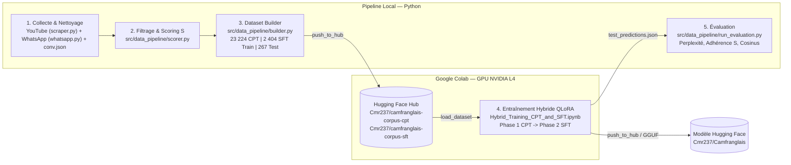
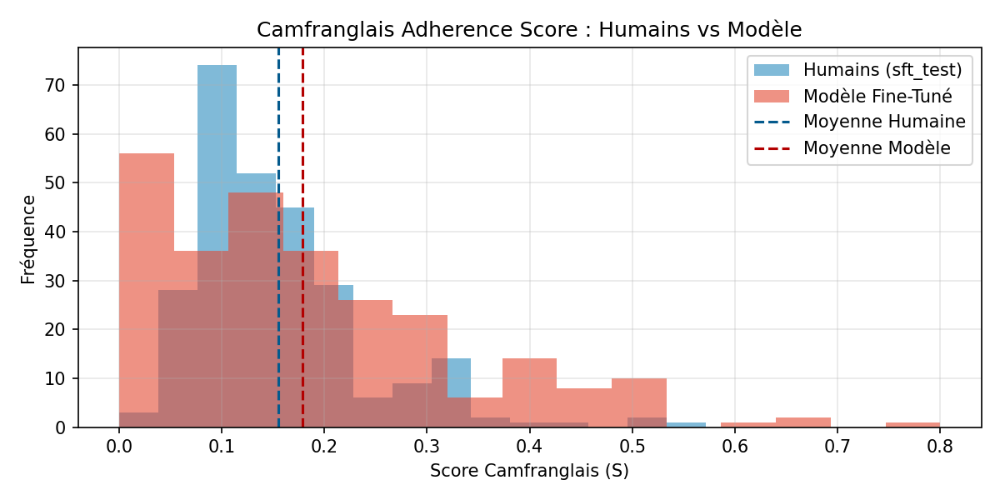

# CameroonianLLM : Fine-Tuning d'un LLM en Camfranglais

Projet réalisé par :
- [Daryl B.](https://github.com/darylbdr)
- [Schadrac](https://github.com/Schadrac237)
- [William Pancha](https://github.com/Williampancha)

---

Ce projet adapte le modèle **`Mistral-Nemo-Instruct-2407`** (12B) au **Camfranglais** à travers une approche hybride en deux temps : **Continued Pre-Training (CPT)** suivi d'un **Supervised Fine-Tuning (SFT)** avec **QLoRA**.

La préparation des données et l'évaluation tournent en local sur CPU via les scripts de [`src/data_pipeline/`](src/data_pipeline/). Seul l'entraînement QLoRA s'exécute sur GPU NVIDIA L4 depuis le notebook [`Hybrid_Training_CPT_and_SFT.ipynb`](Hybrid_Training_CPT_and_SFT.ipynb), en s'appuyant sur Hugging Face Hub pour synchroniser les datasets et héberger les poids finaux :

- **Modèle (Adaptateurs LoRA & GGUF `Q4_K_M`)** : [`Cmr237/Camfranglais`](https://huggingface.co/Cmr237/Camfranglais)
- **Corpus CPT (23 224 textes)** : [`Cmr237/camfranglais-corpus-cpt`](https://huggingface.co/datasets/Cmr237/camfranglais-corpus-cpt)
- **Corpus SFT (2 671 dialogues)** : [`Cmr237/camfranglais-corpus-sft`](https://huggingface.co/datasets/Cmr237/camfranglais-corpus-sft)

---

## Architecture du Pipeline



---

## Structure du Dépôt

```text
CameroonianLLM/
├── config/
│   ├── lexicon.json                     # Lexique Camfranglais issu du Wiktionnaire (321 marqueurs forts, 159 moyens)
│   └── youtube_seeds.json               # Requêtes et paramètres de collecte YouTube Data API v3
├── data/
│   ├── raw/
│   │   ├── raw_comments.jsonl           # 163 283 commentaires extraits (dont 19 133 paires Parent -> Enfant)
│   │   └── scraped_videos.txt           # Liste des vidéos déjà collectées pour éviter les doublons
│   └── final/
│       ├── cpt_train.json               # 23 224 textes en Camfranglais pour la Phase 1
│       ├── sft_train.json               # 2 404 dialogues d'entraînement pour la Phase 2
│       ├── sft_test.json                # 267 dialogues de test
│       ├── evaluation_report.json       # Rapport chiffré généré par run_evaluation.py
│       └── adherence_distribution.png   # Distribution comparée du score S entre humains et modèle
├── src/
│   └── data_pipeline/
│       ├── scraper.py                   # Extraction YouTube en commentaires isolés et fils Parent -> Enfant
│       ├── whatsapp.py                  # Import, pseudonymisation et filtrage des exports WhatsApp
│       ├── scorer.py                    # Nettoyage (emojis répétitifs, liens) et calcul du score linguistique S
│       ├── builder.py                   # Assemblage CPT/SFT, déduplication et envoi sur Hugging Face
│       ├── evaluator.py                 # Fonctions de calcul des métriques d'évaluation
│       ├── run_pipeline.py              # Fusion YouTube + conv_whatsapp.json + conv.json et push Hugging Face
│       └── run_evaluation.py            # Calcul des métriques et génération du graphique sur test_predictions.json
├── conv_whatsapp.json                   # Export conversationnel WhatsApp utilisé par la pipeline
├── conv.json                            # 62 dialogues de salutations et ouvertures conversationnelles
├── Hybrid_Training_CPT_and_SFT.ipynb    # Notebook d'entraînement QLoRA sur GPU L4
├── test_predictions.json                # Réponses générées par le modèle sur les 267 dialogues de test
├── requirements.txt                     # Dépendances Python
└── .env.example                         # Variables d'environnement requises
```

---

## Méthodologie

### 1. Entraînement Hybride : CPT puis SFT

| Phase | Corpus | Objectif | Limite si utilisée seule |
| :--- | :--- | :--- | :--- |
| **Phase 1 : Continued Pre-Training** | **23 224 textes** ([`Cmr237/camfranglais-corpus-cpt`](https://huggingface.co/datasets/Cmr237/camfranglais-corpus-cpt)) | Assimiler le vocabulaire, la syntaxe et les expressions camerounaises par prédiction du mot suivant. | Perte du format assistant : le modèle répond comme un fil de commentaires ou de messages. |
| **Phase 2 : Supervised Fine-Tuning** | **2 671 dialogues** ([`Cmr237/camfranglais-corpus-sft`](https://huggingface.co/datasets/Cmr237/camfranglais-corpus-sft)) | Structurer le dialogue avec le template Mistral `[INST] ... [/INST]` et `train_on_responses_only`. | Vocabulaire trop restreint sans pré-entraînement préalable sur un corpus brut. |
| **Approche Hybride CPT $\rightarrow$ SFT** | **23 224 CPT + 2 671 SFT** | Les mêmes adaptateurs LoRA (`r = 32`) apprennent d'abord la langue à `lr = 1e-4`, puis le format conversationnel à `lr = 5e-5`. | Combine richesse lexicale et tenue du dialogue. |

### 2. Filtrage Linguistique et Score $S$

Pour écarter le français standard et l'anglais ou pidgin pur, [`src/data_pipeline/scorer.py`](src/data_pipeline/scorer.py) attribue à chaque commentaire de $N$ mots le score suivant :

$$S = \mathbb{I}(N \ge 6) \times D_{\text{cam}} \times P_{\text{matrice}}$$

1. **Longueur minimale $\mathbb{I}(N \ge 6)$** : élimine les réactions trop brèves.
2. **Densité lexicale pondérée ($D_{\text{cam}}$)** :
   $$D_{\text{cam}} = \frac{\sum_{i=1}^{N} w_i}{N}$$
   avec $w_i = 2.0$ pour les 321 marqueurs exclusifs du Camfranglais et $w_i = 1.0$ pour les 159 marqueurs secondaires recensés dans [`config/lexicon.json`](config/lexicon.json) à partir de l'[Annexe Camfranglais du Wiktionnaire](https://fr.wiktionary.org/wiki/Annexe:Camfranglais).
3. **Matrice syntaxique ($P_{\text{matrice}}$)** : mesure la proportion de mots-outils français par rapport aux marqueurs anglais/pidgin afin de conserver uniquement les phrases à structure franco-camerounaise.

Pour construire le dataset SFT à partir des fils `Parent -> Enfant`, seule la réponse `Enfant` doit dépasser le seuil $\tau_{\text{haut}} = 0.06$. Le message `Parent` peut rester en français courant afin d'apprendre au modèle à répondre en Camfranglais quelle que soit la formulation de l'utilisateur.

---

## Résultats et Évaluation

L'entraînement a été réalisé sur un GPU **NVIDIA L4 (22.5 Go VRAM)** en `bfloat16` avec `r = 32`, `lora_alpha = 32` et `use_rslora = True`, soit 114M de paramètres entraînables (0.92 % du modèle). Les adaptateurs LoRA et le modèle quantifié au format GGUF `Q4_K_M` sont disponibles sur Hugging Face dans le dépôt [`Cmr237/Camfranglais`](https://huggingface.co/Cmr237/Camfranglais).

### Métriques sur le jeu de test (`sft_test` — 267 dialogues)

| Catégorie | Métrique | Valeur | Analyse |
| :--- | :--- | :---: | :--- |
| **Fluidité** | Eval Loss | `3.7362` | Loss d'évaluation sur les 267 dialogues de test (incluant des paires WhatsApp réelles plus libres). |
| **Fluidité** | Perplexité | **`41.94`** | Mesurée sur l'ensemble des 267 dialogues du jeu de test. |
| **Adhérence au Camfranglais** | Score $S$ moyen du modèle | **`0.1789`** | Très proche du score moyen humain (`0.1551`), avec un écart absolu moyen de seulement `0.0237`. |
| **Adhérence au Camfranglais** | Réponses avec marqueurs Camfranglais | **`81.27 %`** | Part des réponses générées intégrant activement des marqueurs répertoriés dans le lexique. |
| **Pertinence Sémantique** | Similarité Cosinus Modèle / Question | **`0.3891`** | Cohérence thématique avec le prompt utilisateur, montant jusqu'à `0.8810`. |
| **Pertinence Sémantique** | Similarité Cosinus Modèle / Référence | **`0.3309`** | Proximité sémantique avec la vraie réponse humaine, montant jusqu'à `0.7615`. |

### Distribution du Score d'Adhérence $S$



L'histogramme compare la répartition du score $S$ sur les 267 réponses du jeu de test :
- La distribution du modèle suit fidèlement celle des références humaines avec une majorité de réponses ponctuées de marqueurs camfranglais (`81.27 %` actives).
- Le pic à `S = 0.0` regroupe les `18.73 %` de réponses formulées en français standard ou employant des tournures camerounaises sans mot d'argot répertorié dans le lexique.

---

## Exécution

### 1. Installation
```bash
pip install -r requirements.txt
```
Créer un fichier `.env` à la racine à partir de [`.env.example`](.env.example) :
```env
YOUTUBE_API_KEY=votre_cle_youtube
HF_TOKEN=votre_token_huggingface
```

### 2. Pipeline de données local
Pour lancer la collecte, le filtrage et l'envoi des datasets sur Hugging Face Hub :
```bash
python -m src.data_pipeline.run_pipeline
```

### 3. Entraînement sur Google Colab
Ouvrir [`Hybrid_Training_CPT_and_SFT.ipynb`](Hybrid_Training_CPT_and_SFT.ipynb) sur Google Colab avec un GPU **L4**, renseigner le secret `hf_token` puis exécuter les cellules dans l'ordre. À la fin de l'entraînement, le notebook génère le fichier `test_predictions.json`.

### 4. Évaluation locale
Pour calculer les trois métriques et régénérer [`data/final/evaluation_report.json`](data/final/evaluation_report.json) ainsi que [`data/final/adherence_distribution.png`](data/final/adherence_distribution.png) :
```bash
python -m src.data_pipeline.run_evaluation
```
