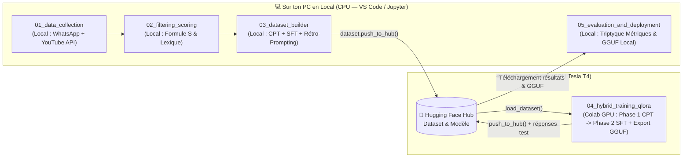

# 🇨🇲 CameroonianAI — Chatbot Conversationnel en Camfranglais (QLoRA & Approche Hybride CPT $\rightarrow$ SFT)

Bienvenue dans le dépôt **CameroonianAI** ! Ce projet a un objectif double :
1. **Objectif technique** : Entraîner un grand modèle de langage (LLM, ici `Mistral-Nemo-Instruct-2407-bnb-4bit` via **Unsloth** et **QLoRA**) pour en faire un **chatbot naturel et fluide en Camfranglais**.
2. **Objectif pédagogique** : Maîtriser de bout en bout un pipeline MLOps complet selon le pattern **Local CPU $\rightarrow$ Hugging Face Hub $\rightarrow$ Colab GPU**.

---

## 🏗️ Architecture MLOps : Notebooks Locaux (CPU) vs Notebook Colab (GPU)

Conformément à notre discussion (page 11 du PDF), **toute la préparation des données et l'analyse d'évaluation tournent en local sur le CPU de ton PC** (dans VS Code ou Jupyter Lab), et **seul l'entraînement QLoRA (Étape 4) tourne sur le GPU de Google Colab** :



### Pourquoi cette séparation est idéale ?
- **Zéro gaspillage de GPU Colab** : Le scraping YouTube, le nettoyage de [`_chat.txt`](_chat.txt), le filtrage par la formule $S$ et le calcul des métriques tournent tranquillement sur ton PC sans consommer une seule minute de GPU.
- **Zéro perte de données** : Tes fichiers bruts (`data/raw/raw_comments.jsonl`) et traités (`data/processed/`, `data/final/`) restent sauvegardés sur ton disque dur local.

---

## 🧠 Pourquoi une Stratégie d'Entraînement Hybride (CPT $\rightarrow$ SFT) ?

| Approche | Volume de données | Ce que le modèle apprend | Limite principale |
| :--- | :--- | :--- | :--- |
| **1. Continued Pre-training (CPT) seul** | Grand (Texte brut : commentaires isolés) | Assimile le vocabulaire (*wanda, mbom, tchop, ngata*), le "flow" et les références culturelles via $P(w_t \mid w_1, \dots, w_{t-1})$. | **Catastrophic Forgetting** : le modèle désapprend son comportement d'assistant et répond comme une section commentaires TikTok/YouTube. |
| **2. Supervised Fine-Tuning (SFT) seul** | Moyen (Paires `User` $\rightarrow$ `Assistant`) | Apprend la posture d'interlocuteur et quand s'arrêter de parler (`<|eot_id|>` / `</s>`). | Camfranglais "scolaire" ou limité s'il ne possède pas déjà un grand réservoir d'expressions idiomatiques. |
| **3. Stratégie Hybride (CPT $\rightarrow$ Petit SFT)** ✅ | **Gros volume brut (CPT) + 1 000 à 2 000 paires de qualité (SFT)** | **Phase 1 (CPT)** : Injecte la langue, l'argot et la syntaxe. <br>**Phase 2 (SFT)** : Réapprend au modèle à dialoguer naturellement grâce au masquage de la *loss* sur l'instruction. | **Le "Sweet Spot" optimal !** |

---

## ⚙️ Installation de l'Environnement Local (pour les Étapes 1, 2, 3 et 5)

1. Installe les dépendances Python légères sur ton PC :
   ```bash
   pip install -r requirements.txt
   ```
2. Copie le fichier [`.env.example`](.env.example) en `.env` à la racine du dépôt et renseigne tes clés (`YOUTUBE_API_KEY`, `HF_TOKEN`, `GEMINI_API_KEY`).

---

## 🗺️ Feuille de Route des 5 Étapes (Notebooks Guidés avec `# TODO`)

### 📦 Configuration Globale
- **[`config/lexicon.json`](config/lexicon.json)** : Le dictionnaire statique du Camfranglais (marqueurs exclusifs à poids fort $w_i = 2.0$, marqueurs partagés à poids moyen $w_i = 1.0$, ancres syntaxiques françaises $C_{\text{fr}}$ et ancres Pidgin/Anglais $C_{\text{en/pid}}$).

### 1️⃣ [Étape 1 — Collecte & Extraction en Arbres (`01_data_collection/`)](01_data_collection/README.md) 💻 *Exécution : EN LOCAL*
- **Objectif** : Réutiliser le parser WhatsApp de [`Cleansing_Dataset.py`](Cleansing_Dataset.py) sur [`_chat.txt`](_chat.txt) (en y ajoutant une fenêtre temporelle $\Delta t \le 30\text{ min}$) et construire un collecteur YouTube Data API v3 (`commentThreads.list`) qui préserve la hiérarchie **Commentaires Isolés (CPT)** vs **Fils `Parent -> Enfant` (SFT)**.
- **Supports** : [📖 Guide Étape 1](01_data_collection/README.md) | [📓 Notebook Local `01_Data_Collection_Scraping.ipynb`](01_data_collection/01_Data_Collection_Scraping.ipynb)

### 2️⃣ [Étape 2 — Filtrage Linguistique & Formule de Scoring $S$ (`02_filtering_scoring/`)](02_filtering_scoring/README.md) 💻 *Exécution : EN LOCAL*
- **Objectif** : Coder le *Funnel Pipeline* en 3 étages et la formule mathématique purement linguistique qui distingue le vrai Camfranglais du Français standard et du Pidgin/Anglais pur :
  $$S = \mathbb{I}(N \ge 6) \times D_{\text{cam}} \times P_{\text{matrice}}$$
- **Supports** : [📖 Guide Étape 2](02_filtering_scoring/README.md) | [📓 Notebook Local `02_Filtering_and_Scoring.ipynb`](02_filtering_scoring/02_Filtering_and_Scoring.ipynb)

### 3️⃣ [Étape 3 — Construction des Datasets (CPT & SFT) & Push HF (`03_dataset_builder/`)](03_dataset_builder/README.md) 💻 *Exécution : EN LOCAL*
- **Objectif** : Assembler `cpt_train.jsonl`, `sft_train.jsonl` et `sft_test.jsonl` en appliquant la **Règle d'Or SFT** (seul l'Enfant doit passer le filtre $S \ge \tau_{\text{haut}}$), fusionner [`conv_bot.json`](conv_bot.json) et [`conversations_dataset.json`](conversations_dataset.json) filtré, générer des paires synthétiques par *Back-translation*, et pousser vers Hugging Face Hub depuis ton PC.
- **Supports** : [📖 Guide Étape 3](03_dataset_builder/README.md) | [📓 Notebook Local `03_Dataset_Builder_and_HF_Push.ipynb`](03_dataset_builder/03_Dataset_Builder_and_HF_Push.ipynb)

### 4️⃣ [Étape 4 — Entraînement Hybride QLoRA : CPT $\rightarrow$ SFT (`04_hybrid_training_qlora/`)](04_hybrid_training_qlora/README.md) ☁️ *Exécution : SUR GOOGLE COLAB (GPU)*
- **Objectif** : **Le seul notebook qui tourne sur Google Colab GPU !** Reprend et corrige [`CameroonianFineTuning.ipynb`](CameroonianFineTuning.ipynb) avec Unsloth :
  1. Téléchargement instantané du dataset depuis Hugging Face Hub (`load_dataset`).
  2. **Phase 1 (CPT)** : Apprentissage de la langue brute avec *Packing* (`packing=True`).
  3. **Phase 2 (SFT Conversationnel)** : Alignement dialogue avec le *Chat Template* natif de Mistral et masquage de la *loss* (`train_on_responses_only`).
  4. Génération des réponses sur `sft_test` + export **GGUF (`q4_k_m`)** vers Hugging Face Hub.
- **Supports** : [📖 Guide Étape 4](04_hybrid_training_qlora/README.md) | [📓 Notebook Colab GPU `04_Hybrid_Training_CPT_and_SFT.ipynb`](04_hybrid_training_qlora/04_Hybrid_Training_CPT_and_SFT.ipynb)

### 5️⃣ [Étape 5 — Évaluation (Le Triptyque de Métriques) & Inférence Locale (`05_evaluation_and_deployment/`)](05_evaluation_and_deployment/README.md) 💻 *Exécution : EN LOCAL*
- **Objectif** : Évaluer scientifiquement en local sur ton PC les réponses générées par le modèle sur `sft_test` via nos 3 métriques complémentaires :
  1. **Perplexité** : $\text{PPL} = \exp(\text{Loss})$
  2. **Camfranglais Adherence Score** : Comparaison de la distribution $(\mu, \sigma)$ du score $S$ du modèle avec celle des humains.
  3. **Pertinence Sémantique** : Similarité Cosinus des embeddings multilingues & LLM-as-a-Judge.
  4. **Inférence locale GGUF** sur ton PC (via `Ollama` / `llama-cpp-python`).
- **Supports** : [📖 Guide Étape 5](05_evaluation_and_deployment/README.md) | [📓 Notebook Local `05_Evaluation_and_GGUF_Export.ipynb`](05_evaluation_and_deployment/05_Evaluation_and_GGUF_Export.ipynb)


---

## 🔗 Du Notebook d'Apprentissage au Package Python Natif (`src/data_pipeline/`)

Pour allier **pédagogie interactive** et **bonnes pratiques d'ingénierie logicielle (MLOps)**, chaque étape locale possède :
1. **Son Notebook `.ipynb`** (pour apprendre, tester chaque fonction isolément et valider les `assert`).
2. **Son Module Python `.py` miroir dans [`src/data_pipeline/`](src/data_pipeline/)** (pour industrialiser le code et le réutiliser d'une étape à l'autre sans copier-coller de cellules) :

| Étape | Notebook d'Apprentissage (Prototypage & Tests) | Module Python Natif (Production & Réutilisation) |
| :--- | :--- | :--- |
| **Étape 1 (Collecte)** | [`01_Data_Collection_Scraping.ipynb`](01_data_collection/01_Data_Collection_Scraping.ipynb) | **[`src/data_pipeline/scraper.py`](src/data_pipeline/scraper.py)** |
| **Étape 2 (Filtrage $S$)** | [`02_Filtering_and_Scoring.ipynb`](02_filtering_scoring/02_Filtering_and_Scoring.ipynb) | **[`src/data_pipeline/scorer.py`](src/data_pipeline/scorer.py)** |
| **Étape 3 (Builder)** | [`03_Dataset_Builder_and_HF_Push.ipynb`](03_dataset_builder/03_Dataset_Builder_and_HF_Push.ipynb) | **[`src/data_pipeline/builder.py`](src/data_pipeline/builder.py)** |
| **Étape 5 (Évaluation)** | [`05_Evaluation_and_GGUF_Export.ipynb`](05_evaluation_and_deployment/05_Evaluation_and_GGUF_Export.ipynb) | **[`src/data_pipeline/evaluator.py`](src/data_pipeline/evaluator.py)** |
| **Jumelage Complet** | — | **[`src/data_pipeline/run_pipeline.py`](src/data_pipeline/run_pipeline.py)** |

### 🚀 Exécuter toute la Data Pipeline en une seule commande
Une fois que tu as validé tes fonctions dans les notebooks 01, 02 et 03 et que tu les as reportées dans [`scraper.py`](src/data_pipeline/scraper.py), [`scorer.py`](src/data_pipeline/scorer.py) et [`builder.py`](src/data_pipeline/builder.py), le script orchestrateur **[`src/data_pipeline/run_pipeline.py`](src/data_pipeline/run_pipeline.py)** jumelle toutes les étapes automatiquement :

```bash
python -m src.data_pipeline.run_pipeline
```
Il charge [`config/lexicon.json`](config/lexicon.json), extrait [`_chat.txt`](_chat.txt) et `data/raw/raw_comments.jsonl`, applique la formule $S$, fusionne [`conv_bot.json`](conv_bot.json), crée les splits `data/final/cpt_train.json`, `sft_train.json` et `sft_test.json`, et prépare l'envoi vers Hugging Face Hub !
